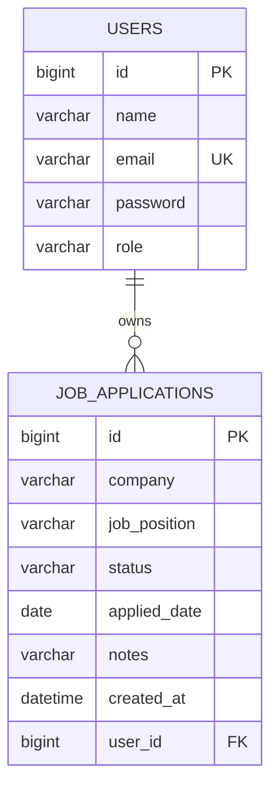

# Job Application Tracker API

A RESTful backend built with **Java, Spring Boot and MySQL** that lets users register, log in and track the jobs they have applied to. It uses JWT authentication, role-based access (USER / ADMIN), a validated status workflow, and a layered architecture.

## Features

- Register and log in with **JWT authentication** (Spring Security, BCrypt password hashing)
- **CRUD APIs** for job applications (company, position, applied date, notes)
- **Status workflow:** `APPLIED -> INTERVIEW -> OFFER`, with `REJECTED` allowed from `APPLIED` or `INTERVIEW`. Invalid changes are rejected.
- **Search, filter and pagination:** filter by status or company, sort and page results
- **Role-based access:** users only see their own applications; `ADMIN` can list all users and all applications
- **Input validation** and **global exception handling** with consistent JSON error responses
- **Swagger / OpenAPI** documentation
- **Unit and integration tests** with JUnit 5, Mockito and MockMvc (H2 in-memory DB)
- Single-page web UI (login, pipeline view, add/edit, status changes, admin tab) served at `/`
- Docker and Docker Compose support

## Tech stack

Java 17, Spring Boot 3.5, Spring Web, Spring Data JPA (Hibernate), Spring Security, JWT (jjwt), MySQL, Bean Validation, springdoc-openapi, JUnit 5, Mockito, Maven

## Architecture

```
controller  ->  service  ->  repository  ->  MySQL
   |              |
   dto        entity / exception
security (JWT filter, user details)   config (security, OpenAPI, admin seeding)
```

## Database (ER diagram)



## Getting started

### Option 1: Run locally

Requirements: JDK 17+, Maven 3.9+, MySQL 8 running on port 3306.

```bash
git clone https://github.com/Swapnanil004/job-application-tracker.git
cd job-application-tracker

# Optional: override defaults (database is created automatically)
export DB_USERNAME=root
export DB_PASSWORD=your_mysql_password

mvn spring-boot:run
```

### Option 2: Docker Compose (app + MySQL)

```bash
docker compose up --build
```

The web app runs at **http://localhost:8080**, the API is under `/api`, and Swagger UI at **http://localhost:8080/swagger-ui.html**.

### Configuration (environment variables)

| Variable | Default | Purpose |
|----------|---------|---------|
| `DB_URL` | local MySQL `job_tracker` | JDBC URL |
| `DB_USERNAME` / `DB_PASSWORD` | `root` / `root` | Database credentials |
| `JWT_SECRET` | demo key | Base64 secret, at least 32 bytes. **Change this in production.** |
| `ADMIN_EMAIL` / `ADMIN_PASSWORD` | `admin@tracker.com` / `Admin@12345` | Admin account created on first start. **Change these.** |

## API endpoints

| Method | Endpoint | Description | Access |
|--------|----------|-------------|--------|
| POST | `/api/auth/register` | Register and get a JWT | Public |
| POST | `/api/auth/login` | Log in and get a JWT | Public |
| POST | `/api/applications` | Create an application | User |
| GET | `/api/applications?status=&company=&page=&size=&sort=` | List, filter, paginate | User |
| GET | `/api/applications/{id}` | Get one application | User |
| PUT | `/api/applications/{id}` | Update details | User |
| PATCH | `/api/applications/{id}/status` | Change status | User |
| DELETE | `/api/applications/{id}` | Delete | User |
| GET | `/api/admin/users` | List all users | Admin |
| GET | `/api/admin/applications` | List all applications | Admin |

## Sample requests

```bash
# Register
curl -X POST http://localhost:8080/api/auth/register \
  -H "Content-Type: application/json" \
  -d '{"name":"Swapnanil","email":"swapnanil@example.com","password":"Password@1"}'

# Log in (copy the token from the response)
curl -X POST http://localhost:8080/api/auth/login \
  -H "Content-Type: application/json" \
  -d '{"email":"swapnanil@example.com","password":"Password@1"}'

# Create an application
curl -X POST http://localhost:8080/api/applications \
  -H "Authorization: Bearer <TOKEN>" -H "Content-Type: application/json" \
  -d '{"company":"Cognizant","position":"Software Engineer","appliedDate":"2026-10-12","notes":"GenC"}'

# Move it to INTERVIEW
curl -X PATCH http://localhost:8080/api/applications/1/status \
  -H "Authorization: Bearer <TOKEN>" -H "Content-Type: application/json" \
  -d '{"status":"INTERVIEW"}'

# List with filter and pagination
curl "http://localhost:8080/api/applications?status=INTERVIEW&page=0&size=5" \
  -H "Authorization: Bearer <TOKEN>"
```

Error responses are consistent JSON, for example a validation failure:

```json
{
  "timestamp": "2026-10-12T10:15:30Z",
  "status": 400,
  "error": "Bad Request",
  "message": "Validation failed",
  "fieldErrors": { "email": "Email must be valid" }
}
```

## Running the tests

```bash
mvn clean test
```

Tests cover the status workflow rules, service logic with Mockito, JWT generation and validation, and the full register, login, create and status-update flow with MockMvc on an H2 database.

## Project structure

```
src/main/java/com/swapnanil/jobtracker
  config/       SecurityConfig, OpenApiConfig, DataSeeder
  controller/   AuthController, ApplicationController, AdminController
  dto/          Request and response records
  entity/       User, JobApplication, Role, ApplicationStatus
  exception/    Custom exceptions and GlobalExceptionHandler
  repository/   Spring Data JPA repositories
  security/     JwtService, JwtAuthFilter, CustomUserDetailsService
src/main/resources/static/index.html   Web UI (plain HTML, CSS and JavaScript)
  service/      AuthService, ApplicationService, UserService
```

## Author

Swapnanil Biswas, [GitHub](https://github.com/Swapnanil004)
